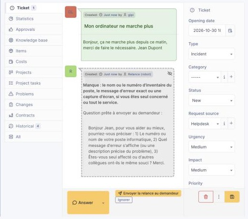
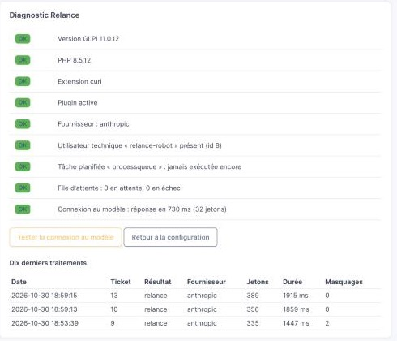

# Relance — plugin GLPI 11

Quand un ticket arrive sans le poste, sans le message d'erreur ou sans dire depuis quand, le technicien perd un aller-retour avec le demandeur avant de pouvoir commencer. Ce plugin pose cette question à sa place, en suivi privé, avant qu'il ouvre le ticket. Il clique, elle part signée de lui. Si rien ne manque, le plugin ne poste rien.

## Ce qu'il fait, exactement

1. À la création d'un ticket, le plugin le met dans une file. Aucun appel réseau à ce moment-là : le collecteur de mails et l'API ne sont pas ralentis.
2. Une action automatique vide la file chaque minute. Pour chaque ticket, elle envoie le titre et la description (masqués, tronqués à 2 000 caractères) au modèle que vous avez configuré et lui demande ce qui manque parmi : nom ou numéro d'inventaire du poste, message d'erreur exact ou capture, depuis quand, une personne ou tout le service.
3. S'il manque quelque chose d'utile pour ce type de demande, le plugin dépose un suivi privé de trois lignes : ce qui manque, puis la question prête à envoyer. Signé par un utilisateur technique « relance-robot ».
4. En bas du ticket, un technicien voit « Envoyer la relance au demandeur » et « Ignorer ». Envoyer ajoute la question en suivi public, signée par lui, et passe le ticket en attente. Le demandeur ne voit jamais le bouton.

Mesuré sur 50 tickets avec Claude Haiku : 49 décisions justes, 1 relance injustifiée, 0 manquée, environ 320 jetons par ticket. Détail dans [docs/evaluation.md](docs/evaluation.md).

## Où vont les données

Le plugin tourne dans votre GLPI. La seule connexion sortante va vers le fournisseur de modèle que vous avez choisi, avec votre clé : OpenAI, Anthropic, ou un Ollama sur votre réseau (rien ne sort alors). Sans clé de licence, le plugin ne contacte aucun autre serveur.

Envoyé au modèle : titre et description du ticket, le nom du demandeur remplacé par un jeton, et un masquage par motifs des mots de passe, IBAN, cartes, NAS, NIR, e-mails et téléphones. Jamais envoyés : pièces jointes, suivis, tâches, champs du demandeur (nom, e-mail, téléphone, lieu), champs personnalisés, historique. Les tickets des catégories que vous excluez (RH, paie, médical, accès…) ne sont pas traités du tout.

Le masquage par motifs rate des choses. Pour un ticket qui contient un secret, excluez la catégorie.

La question rédigée par le modèle est conservée dans GLPI (table du plugin) le temps que le technicien clique : c'est ce qui alimente le bouton. Le journal du plugin ne garde que des métadonnées (ticket, fournisseur, modèle, jetons, durée, code HTTP, nombre de masquages), purgées à 90 jours.

La clé API est chiffrée avec le mécanisme natif de GLPI (`GLPIKey`) et n'est jamais affichée. L'utilisateur technique a un profil dédié « Relance (robot) » : lecture des tickets, ajout et lecture de suivis, rien d'autre, et aucune source d'authentification donc aucune connexion possible.

Fiche de traitement et modèle d'EFVP (loi 25) pré-remplis : [docs/fiche-de-traitement.md](docs/fiche-de-traitement.md), [docs/efvp-modele.md](docs/efvp-modele.md).

## Installation

Testé sur GLPI 11.0.12, PHP 8.2 à 8.5, MariaDB 11. Nécessite l'extension curl. Guide complet : [docs/installation.md](docs/installation.md).

1. Déposer le dossier `relance` dans `plugins/` de votre GLPI (zip dans les [versions](https://github.com/AymerickVic/glpi-relance/releases)).
2. Configuration > Plugins : installer, activer.
3. Configurer : fournisseur, modèle, clé, catégories exclues, puis Activer. Le mode « à blanc » n'appelle aucun modèle et sert à vérifier le circuit.
4. Diagnostic : vérifie la version, l'utilisateur technique, l'action automatique, et teste la connexion au modèle.

Par entité : chaque entité peut avoir sa configuration (onglet Relance dans la fiche de l'entité) ; sinon elle hérite du parent le plus proche qui en a une.

## Ce qu'il ne fait pas encore

- Pas de prise en compte des pièces jointes : si le demandeur a joint une capture, le plugin peut quand même la demander.
- Pas d'envoi automatique au demandeur, et ce n'est pas prévu avant que des équipes aient jugé les brouillons bons pendant un mois.
- Pas de fichier de configuration déployable pour les infogéreurs qui gèrent beaucoup d'instances. C'est le prochain chantier.
- Pas de suggestion d'article de base de connaissances ni de brouillon de réponse. Prévus après, si la relance seule fait ses preuves.

## Modèle

Le code est sous GPLv3, comme GLPI. Vous pouvez l'installer, le lire et le modifier sans rien payer. Une clé de licence, facultative, donnera droit au support et au signalement des nouvelles versions ; elle envoie au serveur de licence la clé, la version du plugin, celle de GLPI et un condensé de l'identifiant d'instance, jamais de contenu. Le tarif n'est pas fixé : je cherche d'abord cinq équipes qui l'essaient sur une instance de test.

## Contribuer, signaler

Issues et questions sur ce dépôt. Je ne suis pas administrateur GLPI de métier : j'ai fait du helpdesk et de l'administration système et réseau, et c'est pour ça que les retours de ceux qui gèrent un GLPI tous les jours comptent plus que le code.

Journal des versions : [CHANGELOG.md](CHANGELOG.md).
